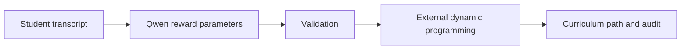

# CityU Course Helper

A local Qwen3-8B assistant that supplies objective-function parameters to an
external course-planning optimiser.

## Open the package

All application code, the current checkpoint, course evidence, tests and reports
are grouped in **[cityu-course-helper/](cityu-course-helper/)**.

- [Setup and running instructions](cityu-course-helper/README.md#quick-start)
- [Current trained checkpoint](cityu-course-helper/adapters/objective-parameters/)
- [Test inputs and outputs](cityu-course-helper/examples/README.md)
- [Comparison report (PDF)](cityu-course-helper/output/pdf/transcript-parameter-pipeline/Transcript_Parameter_Test_Report.pdf)



Qwen supplies parameters and course relations. External software selects courses
and checks the encoded degree requirements. The three included CM demonstrations
reach 122 projected credits within their supplied planning contexts; future
courses with pending timetable details remain clearly marked.

## Clone and enter the package

```powershell
git clone https://github.com/x91k03-del/cityu-course-helper.git
cd cityu-course-helper/cityu-course-helper
```

Then follow the [package README](cityu-course-helper/README.md) to install the
requirements, restore the pinned frozen Qwen base and run a fictional example.
The current trained LoRA checkpoint is included in the repository.

The repository is public for viewing and downloading. The original student
transcript, credentials and browser/session data are excluded. Course-material
provenance and third-party rights are recorded in
[NOTICE.md](cityu-course-helper/NOTICE.md).
