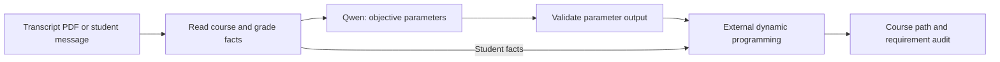

# CityU Course Helper

Run the commands below from this `cityu-course-helper/` package folder.

**A local course-planning assistant with Qwen3-8B and an external optimiser.**

Give the assistant a transcript PDF or a student message. Qwen supplies reward
parameters and course relations; external Python code selects the course path
and checks the encoded graduation requirements.

[**Test examples**](examples/README.md) · [**Current checkpoint**](adapters/objective-parameters/)
· [**Results report**](output/pdf/transcript-parameter-pipeline/Transcript_Parameter_Test_Report.pdf)

## How it works



The model returns only four groups: `reward_parameters`, `course_relations`,
`penalty_weights` and `stream_reward_multiplier`. The interface rejects model
responses containing course selections, timetables or changes to hard requirements.

## Quick start

Use Python and an NVIDIA CUDA-capable GPU for live Qwen inference. The original
run used an RTX 5090 with 32 GB VRAM. Install a CUDA PyTorch build suitable for
your system before installing the remaining requirements.

```powershell
py -m venv .venv
.\.venv\Scripts\python.exe -m pip install -r requirements.txt
.\.venv\Scripts\python.exe tools/verify_checkpoint.py
.\.venv\Scripts\python.exe tools/restore_base_model.py
.\run_transcript_optimizer.cmd F
```

Use `N` or `M` for the other examples, or open `run_transcript_optimizer.cmd`
without an argument for the interactive input. To pass a PDF or a message:

```powershell
.\run_transcript_optimizer.cmd "examples\F\input.pdf"
.\run_natural_student_input.cmd "I am a Year 2 CM student. MA1300: B+, CS1302: A, GE2260: B. I want Financial Mathematics."
```

Outputs are saved in `reports/transcript-parameter-pipeline/latest-run/`, including
exact model inputs, raw parameters, validation and the optimiser's result when a
supported full planning context is available. Other student messages export
parameters and parsed facts; they do not invent a complete degree context.

Poppler `pdftotext` is preferred for PDF reading; a `pypdf` fallback is included.
Project library caches and temporary files stay inside the cloned project folder.

## Examples and recorded results

Each example contains a clearly fictional transcript, the raw Qwen response,
validated parameters and a complete external optimiser output.

| Example | Requested stream | Projected credits | Reward | Transcript / structured-prompt agreement |
| --- | --- | ---: | ---: | --- |
| [F](examples/F/result.txt) | Financial Mathematics | 122 | 154.312078 | Same parameters and path |
| [N](examples/N/result.txt) | Financial Mathematics | 122 | 140.126282 | Same parameters and path |
| [M](examples/M/result.txt) | Enriched Mathematics | 122 | 153.655049 | Same parameters and path |

These three examples were taught after initial failures and are corrective
retests. Eight separate synthetic parameter exports and four new English controls
also passed; the reviewed reward policy and formatting families remain familiar.
The evidence measures input consistency and software behaviour, not student outcomes.

Each CM demonstration satisfies the encoded 122-credit, four-GE/three-area and
mathematics-elective requirements. Exact dynamic programming and independent
checking of 64 allowed elective assignments verify the maximum **within each
supplied fixed completion context**. The comparison is not a global search over
all possible curricula. Twenty-five future credits retain pending timetable
details, and repeated A/B snapshots are an explicit simulation assumption.
These are curriculum plans rather than confirmed registration timetables.

## Included model

The repository includes the current **rank-8 QLoRA adapter**, its configuration
and tokenizer files in [`adapters/objective-parameters/`](adapters/objective-parameters/).
The checkpoint is separate from the frozen Qwen3-8B base.

| Item | Value |
| --- | --- |
| Base | `Qwen/Qwen3-8B` |
| Pinned base revision | `b968826d9c46dd6066d109eabc6255188de91218` |
| Adapter SHA-256 | `62fd3c3bcb8585b36e47e806d9c3c7126801e81953e7b5448a0e11a40d7ec1e8` |
| Loading | Frozen four-bit NF4 base, BF16 computation |

`tools/restore_base_model.py` downloads that exact base revision and verifies its
recorded file hashes. `tools/verify_checkpoint.py` checks the included adapter
without loading the model. Training datasets and training records remain available
as evidence; the current branch focuses on running the released checkpoint.

## Repository guide

| Location | Contents |
| --- | --- |
| `transcript_objective_input.py` | User-facing transcript/message entry point |
| `inference.py`, `stream_base.py` | Local model loading and generation |
| `transcript_parameter_pipeline.py` | Parameter validation and optimiser handoff |
| `curriculum_chain.py`, planning/policy modules | External reward calculation, search and audits |
| [`examples/`](examples/README.md) | Fictional inputs, parameters and resulting plans |
| `adapters/objective-parameters/` | Current trained checkpoint |
| `data/`, `sources/`, `GE_SEMA/` | Course data, programme documents and timetable evidence |
| `reports/`, `output/pdf/` | Recorded comparisons and readable reports |
| `tools/` | Base restoration and checkpoint verification |
| `tests/` | Parameter-contract, path-search and reward checks |
| `docs/history/` | Earlier project notes |

The complete original development package, including older training and report
builders, is preserved in [Git history](https://github.com/x91k03-del/cityu-course-helper/tree/2dae238d65d110600d628274b291721e6853f2a7).

## Run the checks

After installing the Python requirements, these checks run without downloading
base-model weights:

```powershell
.\.venv\Scripts\python.exe -m unittest discover -s tests -p "test_*.py"
.\.venv\Scripts\python.exe tools/verify_checkpoint.py
```

CM and CS course evidence and policy rules are included. The three complete-degree
transcript demonstrations are CM-specific; they do not establish full-degree CS
completion support. Only fictional student examples are included. Source owners'
rights and provenance are recorded in [`NOTICE.md`](NOTICE.md) and `sources/`.
